# Testing

> [!NOTE]  
> Return back to the [README.md](README.md) file.

## Code Validation

### HTML

I have used the recommended [HTML W3C Validator](https://validator.w3.org) to validate all of my HTML files.

| Directory | File | URL | Screenshot | Notes |
| --- | --- | --- | --- | --- |
|  | [index.html](https://github.com/bas-nab-1/TheStockCounter/blob/main/index.html) | [HTML Validator](https://validator.w3.org/nu/?doc=https%3A%2F%2Fbas-nab-1.github.io%2FTheStockCounter%2F) | 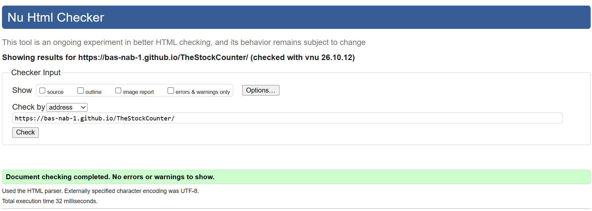 |  |
|  | [404.html](https://github.com/bas-nab-1/TheStockCounter/blob/main/404.html) | [HTML Validator](https://validator.w3.org/nu/?doc=https%3A%2F%2Fbas-nab-1.github.io%2FTheStockCounter%2F404) | 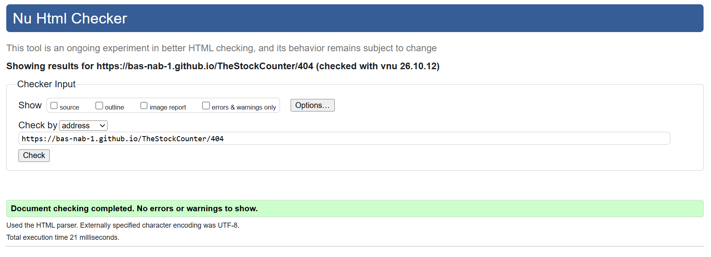 |  |

### CSS

I have used the recommended [CSS Jigsaw Validator](https://jigsaw.w3.org/css-validator) to validate all of my CSS files.

| Directory | File | URL | Screenshot | Notes |
| --- | --- | --- | --- | --- |
| assets | [style.css](https://github.com/bas-nab-1/TheStockCounter/blob/main/assets/css/style.css) | [CSS Validator](https://jigsaw.w3.org/css-validator/validator?uri=https%3A%2F%2Fbas-nab-1.github.io%2FTheStockCounter%2F&profile=css3svg&usermedium=all&warning=1&vextwarning=&lang=en) | 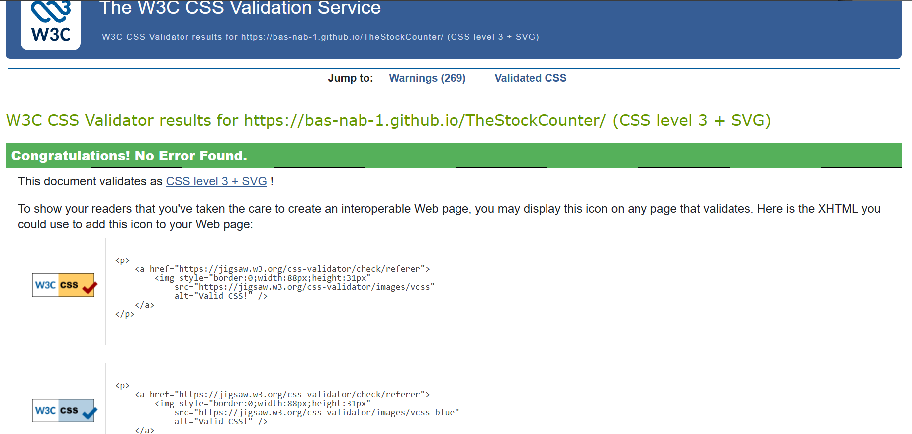 |  |

### JavaScript

**IMPORTANT**: External resources

I have used the recommended [JShint Validator](https://jshint.com) to validate all of my JS files.

| Directory | File | URL | Screenshot | Notes |
| --- | --- | --- | --- | --- |
| assets | [script.js](https://github.com/bas-nab-1/TheStockCounter/blob/main/assets/js/script.js) |  | 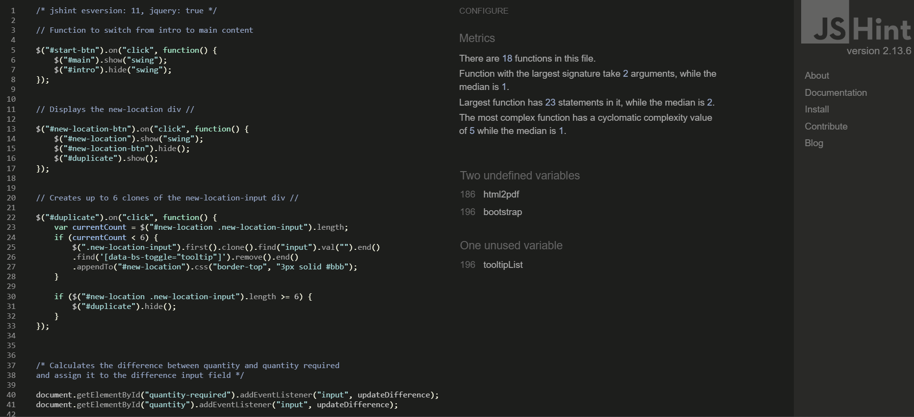 | The Bootstrap and html2pdf external libraries appear as undefined variables |

## Responsiveness

I've tested my deployed project to check for responsiveness issues.

| Page | Mobile | Tablet | Desktop | Notes |
| --- | --- | --- | --- | --- |
| Home (intro) | 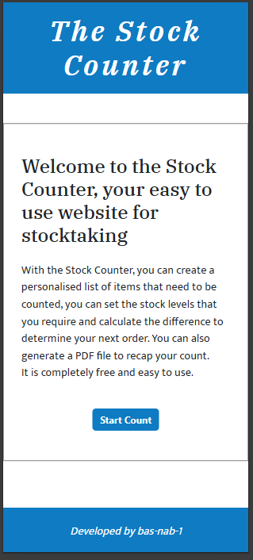 | 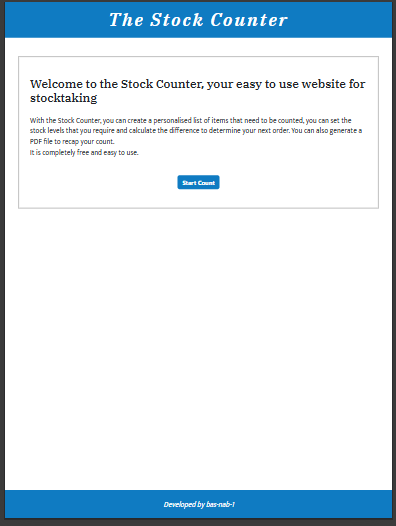 | 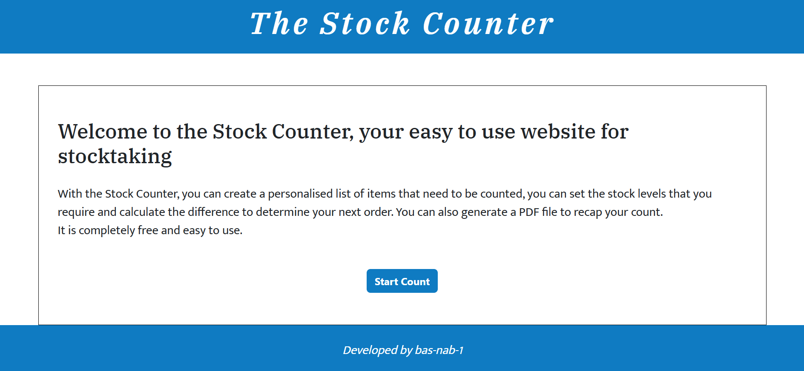 | Works as expected |
| Home (start count) | 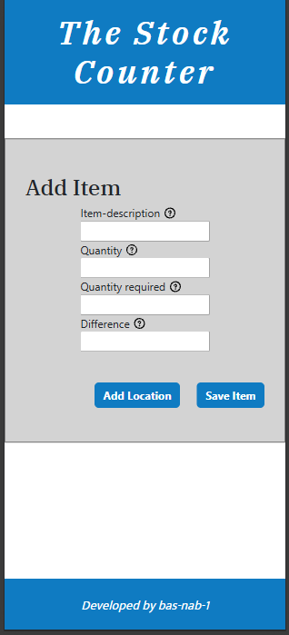 | 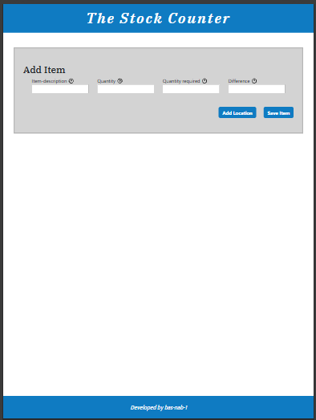 | 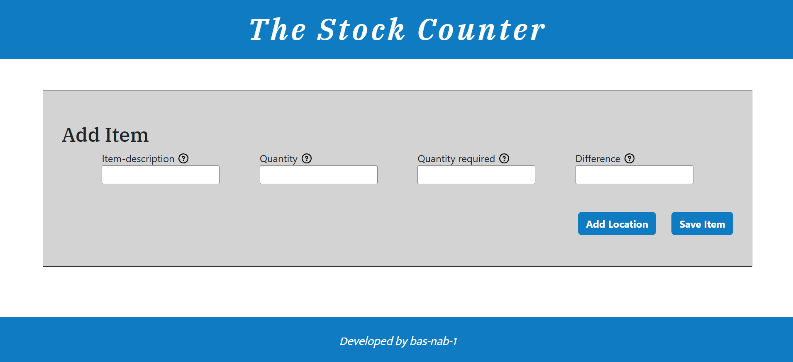 | Works as expected |
| 404 | 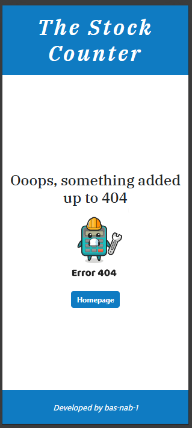 | 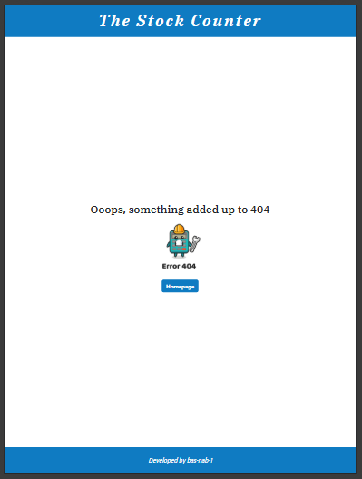 | 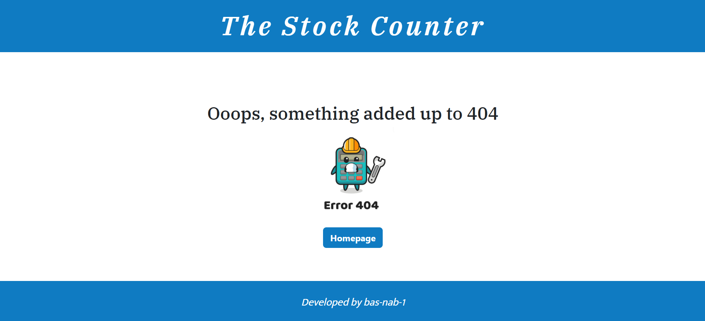 | Works as expected |

## Browser Compatibility

I've tested my deployed project on multiple browsers to check for compatibility issues.

| Page | Edge | Firefox | Opera | Notes |
| --- | --- | --- | --- | --- |
| Home (intro) | 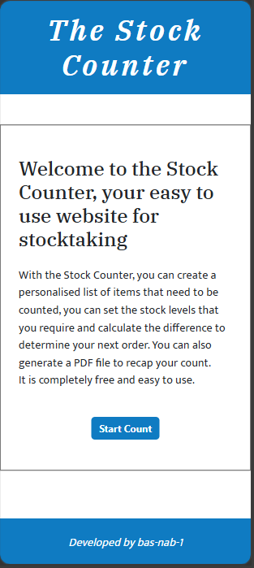 | 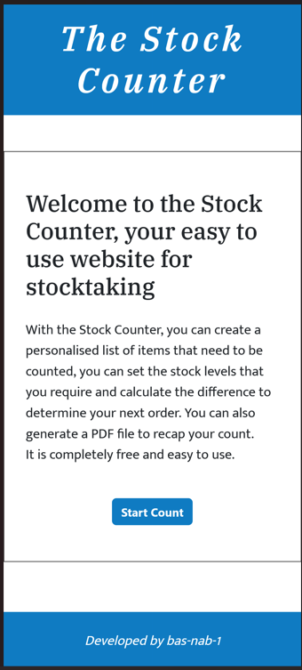 | 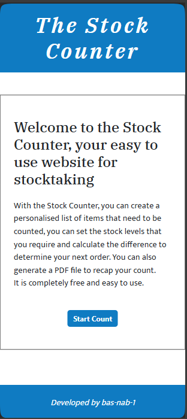 | Works as expected |
| Home(Start Count)  | 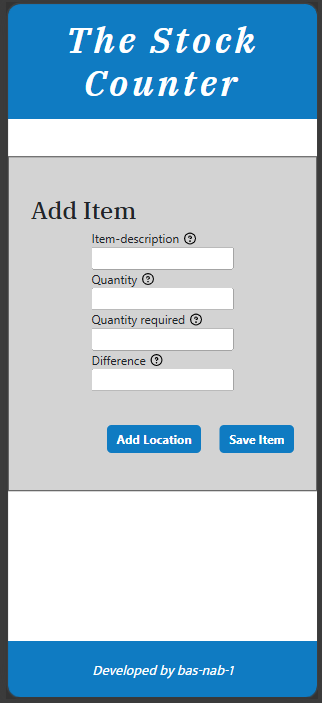 | 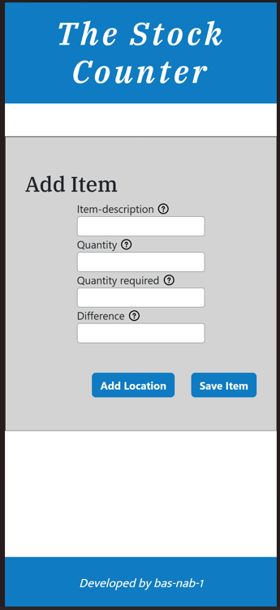 | 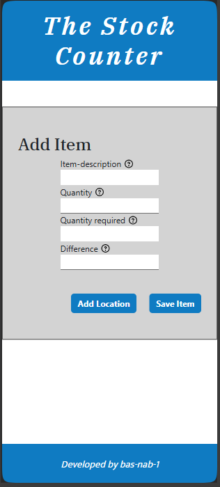 | Works as expected |
| 404 | 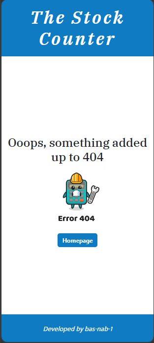 | 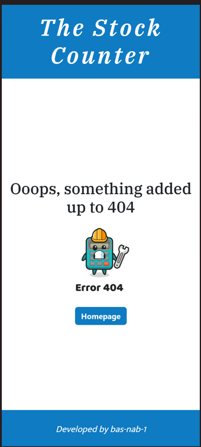 | 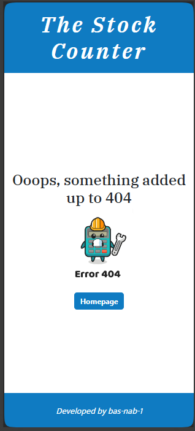 | Works as expected |

Note: Chrome was used to test responsiveness and is also working as expected.

## Lighthouse Audit

I've tested my deployed project using the Lighthouse Audit tool to check for any major issues. Some warnings are outside of my control, and mobile results tend to be lower than desktop.

| Page | Mobile | Desktop |
| --- | --- | --- |
| Home | 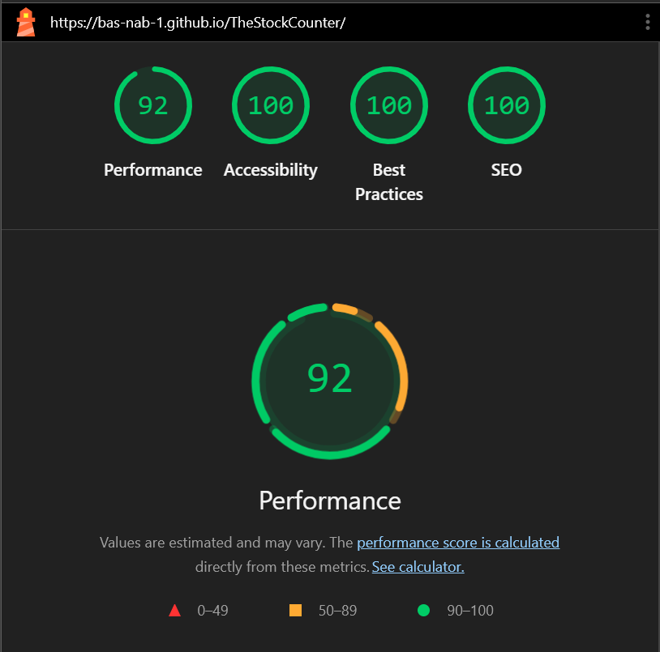 | 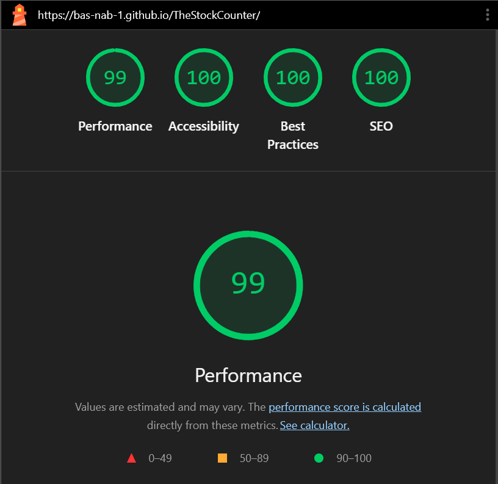 |
| 404 | 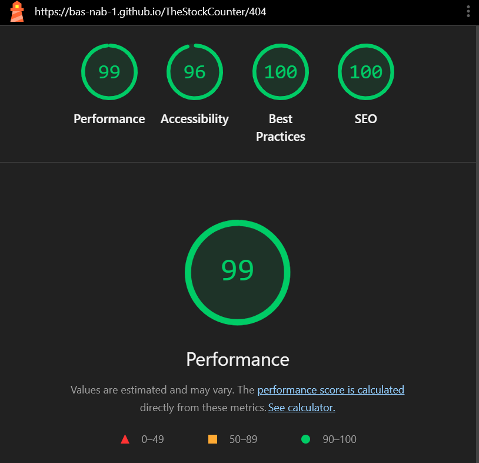 | 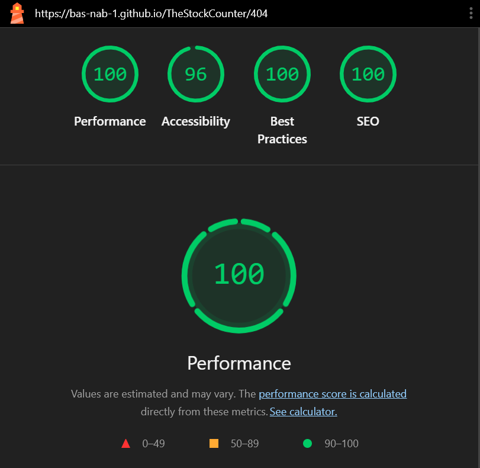 |

## Defensive Programming

⚠️ INSTRUCTIONS ⚠️

Defensive programming (defensive design) is extremely important! When building projects that accept user inputs or forms, you should always test the level of security for each form field. Examples of this could include (but not limited to):

All Projects:

- Users cannot submit an empty form (add the `required` attribute)
- Users must enter valid field types (ensure the correct input `type=""` is used)
- Users cannot brute-force a URL to navigate to a restricted pages

Python Projects:

- Users cannot perform CRUD functionality if not authenticated (if login functionality exists)
- User-A should not be able to manipulate data belonging to User-B, or vice versa
- Non-Authenticated users should not be able to access pages that require authentication
- Standard users should not be able to access pages intended for superusers/admins

You'll want to test all functionality on your application, whether it's a standard form, or CRUD functionality, for data manipulation on a database. Try to access various pages on your site as different user types (User-A, User-B, guest user, admin, superuser). You should include any manual tests performed, and the expected results/outcome.

Testing should be replicable (can someone else replicate the same outcome?). Ideally, tests cases should focus on each individual section of every page on the website. Each test case should be specific, objective, and step-wise replicable.

Instead of adding a general overview saying that everything works fine, consider documenting tests on each element of the page (eg. button clicks, input box validation, navigation links, etc.) by testing them in their "happy flow", their "bad/exception flow", mentioning the expected and observed results, and drawing a parallel between them where applicable.

Consider using the following format for manual test cases:

- Expected Outcome / Test Performed / Result Received / Fixes Implemented

- **Expected**: "Feature is expected to do X when the user does Y."
- **Testing**: "Tested the feature by doing Y."
- (either) **Result**: "The feature behaved as expected, and it did Y."
- (or) **Result**: "The feature did not respond to A, B, or C."
- **Fix**: "I did Z to the code because something was missing."

Use the table below as a basic start, and expand on it using the logic above.

⚠️ --- END --- ⚠️

Defensive programming was manually tested with the below user acceptance testing:

| Page/Feature | Expectation | Test | Result | Screenshot |
| --- | --- | --- | --- | --- |
| Start Count Button | The feature is expected to hide the intro text and display the section for the user to create a new item | Clicked the button and the intro section disappear and the add item section is displayed. | Button worked as expected. | 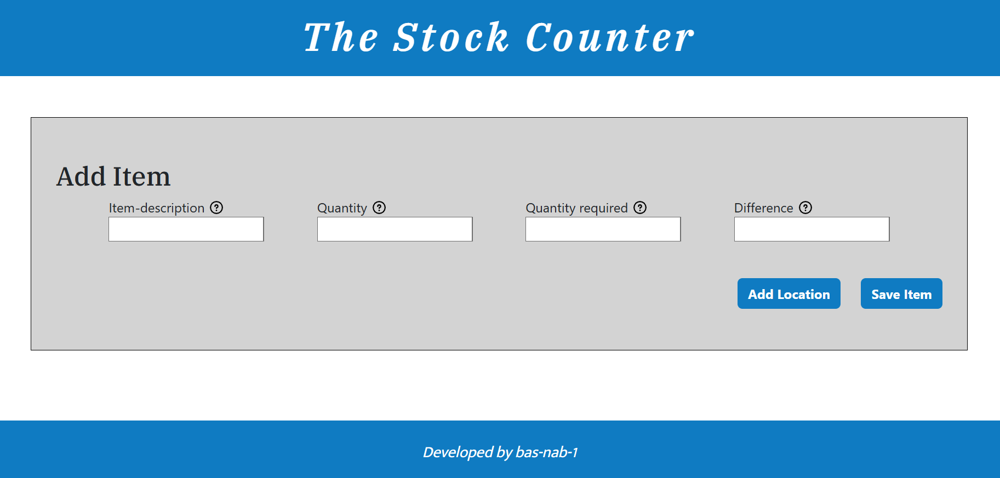 |
| Item-description | Feature is expected to allow the user to input a description/name of the item. It is a mandatory field in order to save the item, with a maximum length of 25 characters. | Try saving with an empty value and alert message was displayed and entered 25 characters and couldn't add any after that. | The input behaved as expected. | 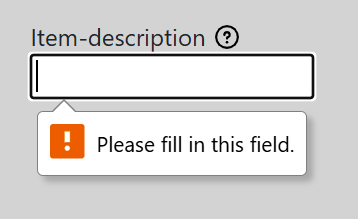 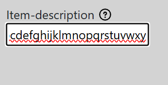 |
| Quantity | Feature is expected to allow the user to input the quantity of the item they currently have in stock. It is a number only, mandatory field in order to save the item, requiring a number equal or greater than 0. | I tried saving with an empty value and an alert message was displayed, tried entering values other than numbers and an alert message was informing the user of a wrong character input, and finally I tried to save a negative number and an alert message was displayed informing the user of an invalid number. | The input behaved as expected. | 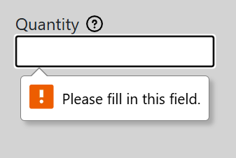 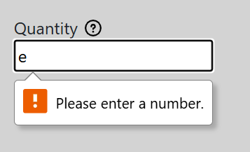 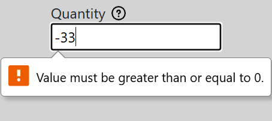 |
| Quantity required | Feature allows the user to enter the quantity they require to have in stock. It links to the difference calculator which is the next feature. It is not mandatory in order to save the item but is number only input field. | Tried entering a value that was not a number and nothing appeared in the input. | The input behaved as expected. | 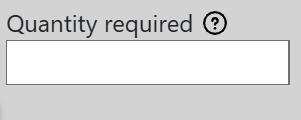 |
| Difference | This features calculates the difference between the quantity and the quantity required. It is a readonly field therefore cannot be modified by the user. To give a result, the user needs to input a quantity and a quantity required | Tried entering quantity and quantity required and the calculated displayed the difference. | The input behaved as expected | 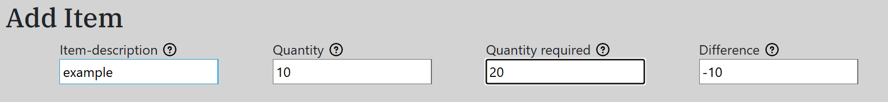 |
| Add Location Button | The feature is expected to display the new-location div | Clicked the button and the required div is displayed. | Button worked as expected. | 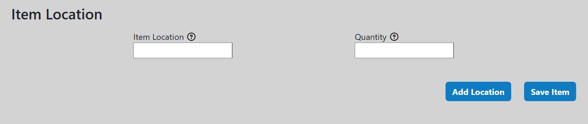 |
| Add Location Button (#duplicate) | The feature is expected to create a clone of new-location-input, in effect adding a line where the user can enter another location. It can clone up to six lines (including the first one). This button has the same text and to the user appear as the same but is in reality a different button than the first Add Location button, because the JavaScript functions attached to it are different. When all 5 clones are created, the button is removed indicating the maximum number of copies have been reached. | Clicked the button and 5 identical new-location-input were created. The button then was removed | Button worked as expected. | 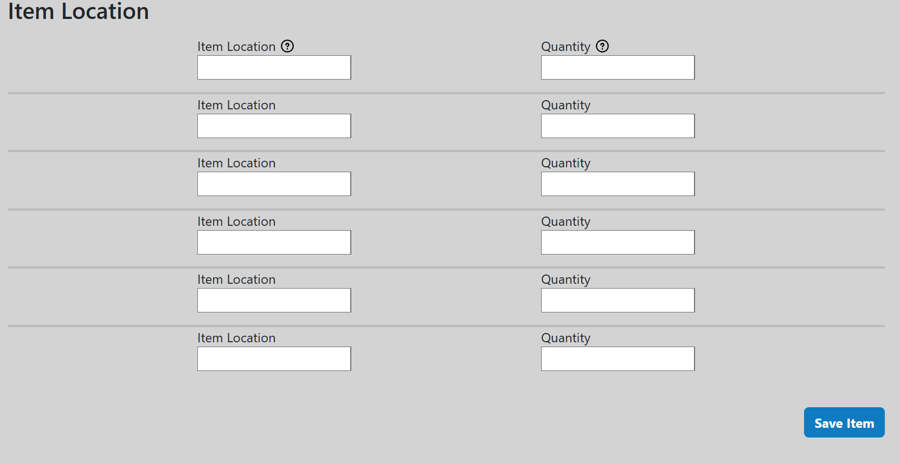 |
| Item Location | This features is optional and allows the user to input the location where the item was counted | I entered a value | The input behaved as expected | 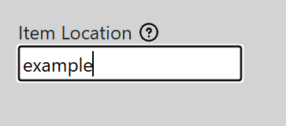 |
| Quantity(location) | This feature allows the user to input the count of an item in the location specified before. When a number is entered the overall quantity at the top is updated and so is the difference calculator as long as a quantity required is provided | I entered a values in the inputs and the overall quantity was updated and so was the difference calculator | The input behaved as expected | 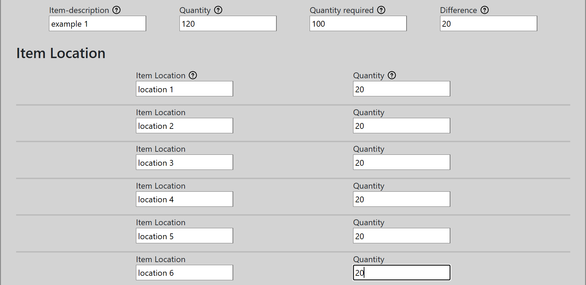 |
| Save Button | Quite significantly the feature with the most tasks to execute. When the user clicks the button, the inputs of item description, quantity, quantity required and difference will be transfered to a table that will be displayed, creating a new line for each item saved. All inputs will be cleared and the add location item will be hidden and all cloned divs removed. Essentially reseting the entire input fields section. It also checks that the input required are valid. | Clicked the save button for four different items saved and the page returned to its required state | Button worked as expected. | 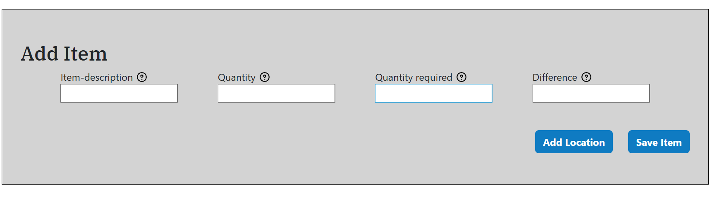 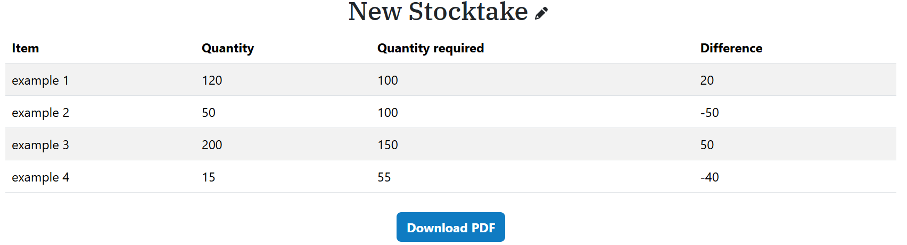 |
| | Feature is expected to display buttons that are clear, large, and easy to select on all devices. | Verified button sizes and usability across multiple devices (mobile, tablet, desktop). | Buttons were accessible and easy to use on all tested devices. | 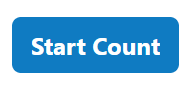 |
| | Feature is expected to use high-contrast colors and accessible fonts. | Checked contrast ratios using webAIM Contrast Checker. | Colors and fonts met accessibility standards. | 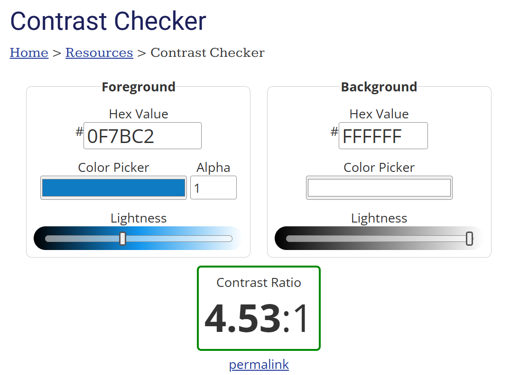 |
| | Feature is expected to have clear labels and instructions for user guidance. | Reviewed labels and instructions for clarity and ease of use. | Labels and instructions were clear and intuitive. | 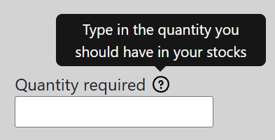 |
| 404 Error Page | Feature is expected to display a 404 error page for non-existent pages. | Navigated to an invalid URL (e.g., `/test`) to test error handling. | A custom 404 error page was displayed as expected. | 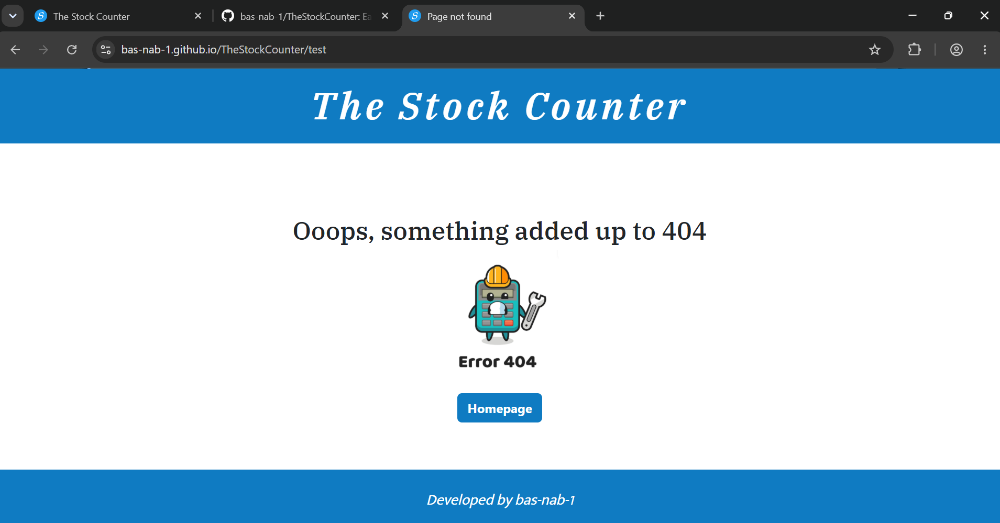 |

## User Story Testing

| Target | Expectation | Outcome | Screenshot |
| --- | --- | --- | --- |
| As a first time user | I need easy navigation and a user-friendly design, including a responsive layout for my device | so I can find information quickly and efficiently without frustration |    |
| As a user |  I want to have the possibility to create a list of the items | so that I can count the specific products of my company |  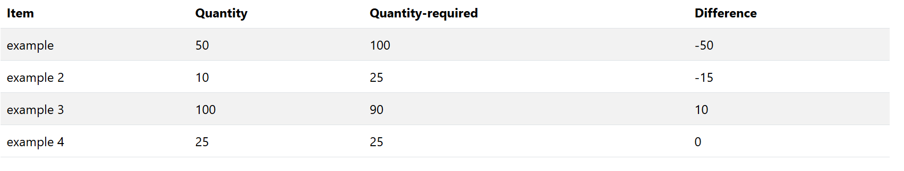 |
| As a first time user |  i want to have easily accessible relevant explanations on how to use the website | so that i can use the website's features |   |
| As a user | I would like to have the possibility to count the same item in different locations | so that I can keep track of my count |  |
| As a user |  I want the possibility to generate a report of my count on a pdf document |  so that I can access it or print it away from the website |  |
| As a user | I would like to see a 404 error page if I get lost | so that it's obvious that I've stumbled upon a page that doesn't exist. | 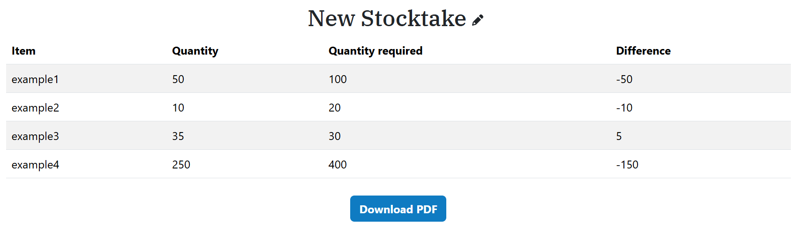  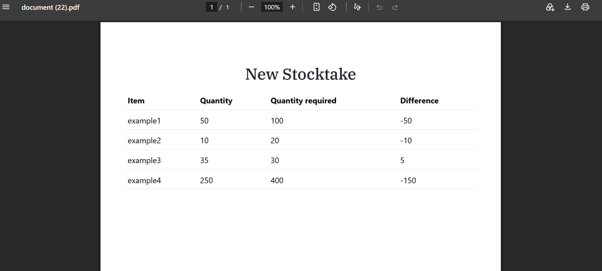 |

## Bugs

### Fixed Bugs

I've used [GitHub Issues](https://www.github.com/bas-nab-1/TheStockCounter/issues) to track and manage bugs and issues during the development stages of my project.

All previously closed/fixed bugs can be tracked [here](https://www.github.com/bas-nab-1/TheStockCounter/issues?q=is%3Aissue+is%3Aclosed+label%3Abug).

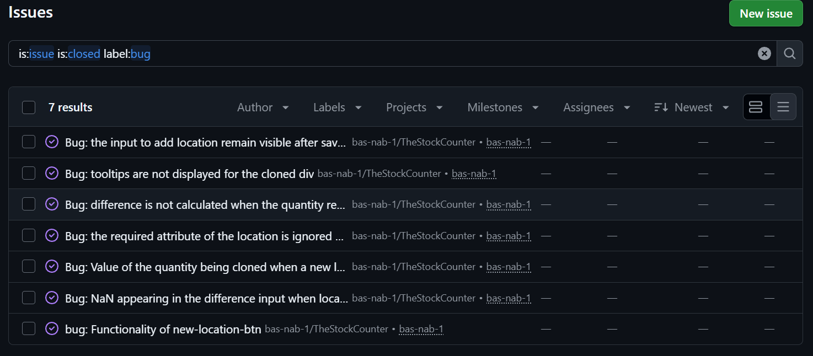

### Unfixed Bugs

Any remaining open issues can be tracked [here](https://www.github.com/bas-nab-1/TheStockCounter/issues?q=is%3Aissue+is%3Aopen+label%3Abug).

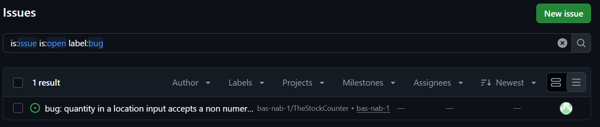

### Known Issues

| Issue | Screenshot |
| --- | --- |
| The project is designed to be responsive from `375px` and upwards, in line with the material taught on the course LMS. Minor layout inconsistencies may occur on extra-wide (e.g. 4k/8k monitors), or smart-display devices (e.g. Nest Hub, Smart Watches, Gameboy Color, etc.), as these resolutions are outside the project’s scope, as taught by Code Institute. | 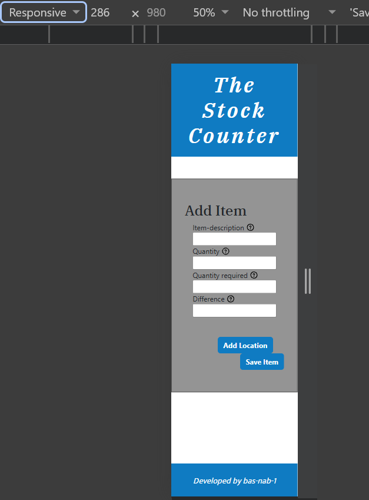 |

> [!IMPORTANT]  
> There are no remaining bugs that I am aware of, though, even after thorough testing, I cannot rule out the possibility.

